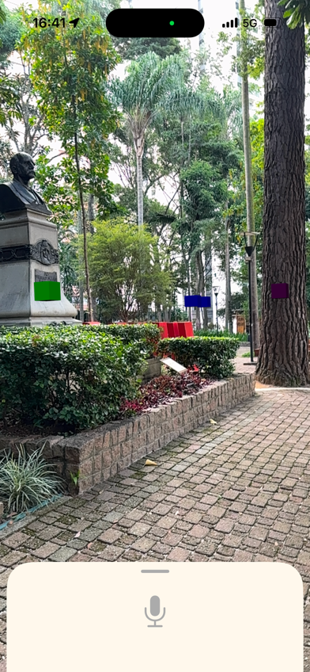
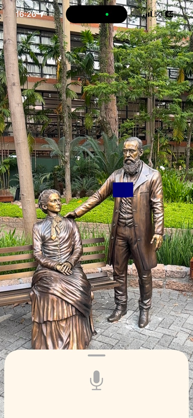
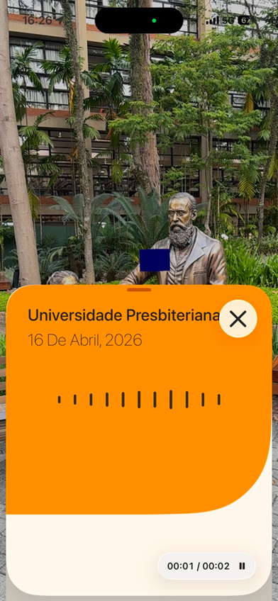
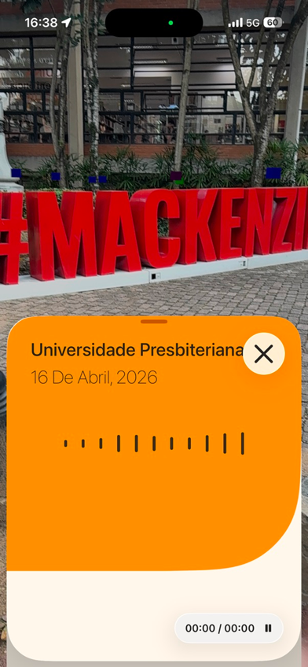

<div align="center">


# Vivacidade

[](https://developer.apple.com/ios/)
[](https://swift.org)
[](https://developer.apple.com/augmented-reality/)
[](LICENSE)

Record audio memories and pin them to real places in augmented reality, so anyone passing by can hear them.

<a href="https://apps.apple.com/br/app/vivacidade/id6761855371">
  
</a>

</div>

## Table of Contents

- [About](#about)
- [Features](#features)
- [Screenshots](#screenshots)
- [Built With](#built-with)
- [Getting Started](#getting-started)
- [Project Structure](#project-structure)
- [Team](#team)
- [License](#license)

## About

Vivacidade ("city liveliness") was built at the Apple Developer Academy | Mackenzie
around one idea: give people back moments of contemplation in the city they cross
every day. Users record short audio memories and anchor them to places they choose,
using the iPhone camera and augmented reality. Each recording becomes a colored cube
floating in the real world that can be shared, so other people can live that moment
when they walk by the same spot. The app is published on the App Store and its UI is
in Portuguese.

## Features

- Record and play back audio memories with a live waveform
- Place each memory as a 3D object in the real world with ARKit and RealityKit
- Geolocated memories with Core Location and MapKit
- Library of recorded memories stored with Core Data
- Share a memory as a custom file; opening that file launches the app and imports it

## Screenshots

| Memories in AR | Pinned memory | Listening | Memory card |
| :---: | :---: | :---: | :---: |
|  |  |  |  |

## Built With

- UIKit with programmatic view controllers
- ARKit and RealityKit for world tracking and 3D anchors
- AVFoundation for recording and playback
- Core Data, Core Location, MapKit and Core Motion
- Custom document type with `UIDocument` and a document picker for sharing

## Getting Started

Requirements: Xcode 26 or later and an iPhone with iOS 26 (augmented reality does not
run in the Simulator).

```bash
git clone https://github.com/EnzoFerroni/Vivacidade.git
cd Vivacidade
open ProjectCidadeParaPessoas/ProjectCidadeParaPessoas.xcodeproj
```

Select your device, set your own signing team and press Run.

## Project Structure

```
ProjectCidadeParaPessoas/ProjectCidadeParaPessoas/
├── App/            AppDelegate, SceneDelegate
├── Controllers/    AR view, audio sheet, library, Core Data
├── Services/       Audio, Core Data, geolocation, sharing, sheets
├── Models/         CuboModel (an audio memory placed in the world)
├── ViewModels/     CustomARViewModel
├── Views/          AR view, waveform, playback timer, library cell
└── FilePicker/     Custom document type and picker
```

## Team

<div align="center">
  <table>
    <tr>
      <td align="center" width="25%">
        <a href="https://github.com/EnzoFerroni"></a>
        <br/><sub><b>Enzo Ferroni</b></sub><br/><br/>
        <a href="https://github.com/EnzoFerroni"></a>
        <a href="https://www.linkedin.com/in/enzoferroni/"></a>
      </td>
      <td align="center" width="25%">
        <a href="https://github.com/gsgonca"></a>
        <br/><sub><b>Gabriel Gonçalves</b></sub><br/><br/>
        <a href="https://github.com/gsgonca"></a>
        <a href="https://www.linkedin.com/in/gabriel-s-gon%C3%A7alves/"></a>
      </td>
      <td align="center" width="25%">
        <a href="https://github.com/JonasFNMelo"></a>
        <br/><sub><b>Jonas Melo</b></sub><br/><br/>
        <a href="https://github.com/JonasFNMelo"></a>
        <a href="https://www.linkedin.com/in/jonas-melo-/"></a>
      </td>
      <td align="center" width="25%">
        <a href="https://github.com/TamiresMendesS"></a>
        <br/><sub><b>Tamires Mendes</b></sub><br/><br/>
        <a href="https://github.com/TamiresMendesS"></a>
        <a href="https://www.linkedin.com/in/tamires-mendes-6006792b7/"></a>
      </td>
    </tr>
    <tr>
      <td align="center" width="25%">
        <a href="https://github.com/hyauss"></a>
        <br/><sub><b>Vinicius Marques</b></sub><br/><br/>
        <a href="https://github.com/hyauss"></a>
        <a href="https://www.linkedin.com/in/vinicius-marques-966918274/"></a>
      </td>
    </tr>
  </table>
</div>

Fork of the team repository [C12G4/ProjectCidadeParaPessoas](https://github.com/C12G4/ProjectCidadeParaPessoas).

## License

Released under the [MIT License](LICENSE). Copyright (c) 2026 Enzo Ferroni, Gabriel Gonçalves, Jonas Melo, Tamires Mendes and
Vinicius Marques.
